# Lore — System Architecture

> Renders automatically on GitHub. An editable **draw.io** version is in
> [`lore-architecture.drawio`](./lore-architecture.drawio) — open it at
> [app.diagrams.net](https://app.diagrams.net) or with the VS Code "Draw.io Integration" extension.

Lore is three layers on one governed knowledge graph: an **employee workspace** (why people open it
daily), a **knowledge layer** (why the answers are trustworthy), and a **knowledge-ops platform**
(why the company pays). The eval harness, provenance and permissions sit underneath all three.

```mermaid
flowchart TB
    %% ===== Actors =====
    subgraph USERS["👥 Users & Agents"]
        direction LR
        EMP["Employee<br/>(member)"]
        ED["HR / Curator<br/>(editor)"]
        ADM["Admin"]
        GST["Guest"]
        AG["Agent / Bot<br/>(Claude Code…)"]
    end

    %% ===== Frontend =====
    subgraph FE["🖥️ Frontend — Next.js 16 (role-based, dark/light)"]
        direction LR
        FE1["Home<br/>start-my-day briefing"]
        FE2["Workspace<br/>outcome dashboard + pop-up tools:<br/>Create deliverable · Meeting · Document"]
        FE3["Ask — stream · Why · Challenge<br/>· Turn-this-into"]
        FE4["Search · Projects<br/>· Documents (history · impact ·<br/>Knowledge Check · simulate · canonical)"]
        FE5["Gaps · Health · Autopilot<br/>· Onboarding · Add docs · Admin"]
    end

    %% ===== API =====
    subgraph API["⚙️ HTTP API — FastAPI (Bearer JWT · RBAC · ACL · per-thread Kùzu conns)"]
        direction LR
        AP1["/ask · /answers/challenge<br/>/answers/stale · /compose"]
        AP2["/workspace/home · /deliverables/*<br/>/meetings/analyze · /docint/*<br/>/projects/* · /search/all · /me/briefing"]
        AP3["/knowledge/check · /impact · /history<br/>/diff · /documents/simulate · /apply<br/>/documents/canonical · /ambiguities"]
        AP4["/alerts · /autopilot · /audit<br/>/gaps · /ingest* · /auth · /admin"]
    end
    MCP["🔌 MCP Server (FastMCP)<br/>ask · search_all · generate_deliverable · analyze_meeting<br/>check_document_policy · ask_project · attention_digest · …"]

    %% ===== Core =====
    subgraph WS["🧑‍💻 Employee workspace layer"]
        direction LR
        W1["workspace.py<br/>active work · signals · recent work"]
        W2["deliverables.py<br/>grounded, cited drafts"]
        W3["meetings.py · docintel.py<br/>+ policy check"]
        W4["projects.py · briefing.py<br/>search.py · compose.py"]
    end
    subgraph KL["🛡️ Knowledge layer (trust)"]
        direction LR
        K1["retrieval/answer<br/>ACL · temporal · authority/canonical · cite"]
        K2["health.py<br/>conflicts + resolution"]
        K3["knowledge.py<br/>impact · diff · Knowledge Check · ambiguity"]
        K4["provenance.py · challenge.py<br/>simulate.py"]
    end
    subgraph OPS["📊 Knowledge-ops layer"]
        direction LR
        O1["alerts.py · autopilot.py"]
        O2["analytics.py (audit · ROI · gaps)"]
        O3["eval.py — harness + regression gate"]
    end

    %% ===== Data / AI / Sources =====
    subgraph KUZU["🗄️ Knowledge Graph — Kùzu (embedded)"]
        direction LR
        G1["Company · Document<br/>{audience · version · authority · canonical}"]
        G2["DocumentVersion · Fact · Topic"]
        G3["Answer {cited docs @ versions}"]
        G4["Project · ProjectEntry · Deliverable"]
        G5["User · EmployeeQuestion · GlossaryTerm<br/>Feedback · Escalation · Ticket"]
    end
    subgraph AI["🤖 LLM & Embeddings"]
        direction LR
        AI1["Groq — gpt-oss-20b extract<br/>gpt-oss-120b generate/judge/stream"]
        AI2["fastembed (local)<br/>bge-small-en-v1.5"]
    end
    subgraph SRC["📥 Ingestion sources"]
        direction LR
        S1["Files CSV·JSON·TXT·MD·PDF·DOCX"]
        S2["Google Drive"]
        S3["Paste · gap drafts · applied changes"]
    end

    %% ===== Flows =====
    USERS -->|browser| FE
    AG -.->|MCP tools| MCP
    FE -->|"HTTPS + Bearer JWT"| API
    API --> WS
    API --> KL
    API --> OPS
    MCP -.-> WS
    MCP -.-> KL
    WS -->|grounds in| KL
    OPS -->|gates| KL
    KL -->|Cypher read/write| KUZU
    WS -->|read/write| KUZU
    KL -->|extract · answer · judge · embed| AI
    WS --> AI
    KL -->|ingest| SRC

    classDef u fill:#dae8fc,stroke:#6c8ebf;
    classDef f fill:#d5e8d4,stroke:#82b366;
    classDef a fill:#ffe6cc,stroke:#d79b00;
    classDef w fill:#e8f3ff,stroke:#5b8def;
    classDef k fill:#fff2cc,stroke:#d6b656;
    classDef o fill:#f3e8ff,stroke:#8b5cf6;
    classDef g fill:#f8cecc,stroke:#b85450;
    classDef ai fill:#e1d5e7,stroke:#9673a6;
    class EMP,ED,ADM,GST,AG u;
    class FE1,FE2,FE3,FE4,FE5 f;
    class AP1,AP2,AP3,AP4,MCP a;
    class W1,W2,W3,W4 w;
    class K1,K2,K3,K4 k;
    class O1,O2,O3 o;
    class G1,G2,G3,G4,G5 g;
    class AI1,AI2 ai;
    class S1,S2,S3 f;
```



## The loop

```
ANSWER  (cited · why · challenge)  →  AUDIT  (gaps · conflicts · stale · alerts · ambiguity)
   →  CHANGE  (versions · impact · simulate · Knowledge Check gate · canonical)
   →  IMPROVE  (gap → draft → publish → verify)  →  RE-EVALUATE  (stale answers → re-answer)  →  repeat
```

The **employee workspace** sits on top of this loop: a deliverable, meeting recap or document
check is produced *from* the governed knowledge (grounded, cited, permission-filtered) and saved
as the person's recent work — so "help me get work done" and "a trustworthy, auditable AI layer"
are the same system.

## Deployment

Docker Compose → **api** (uvicorn, embedding model baked into the image) + **web** (Next.js
standalone), a persistent named volume for the Kùzu graph, and `GROQ_API_KEY` injected at
runtime from `.env`. The sample company seeds on first boot. Kùzu is single-writer: to run the
eval gate against the live graph, stop the api container first
(`docker compose run --rm --entrypoint python api -m lore.eval --gate`).

## Request flow (an answer)

1. Browser sends the question with a **Bearer token** → API resolves **identity (company, groups, role)**.
2. `retrieve()` embeds the (glossary-expanded) query, scores every **Fact** by cosine, **drops facts the caller's groups can't see**, filters/demotes superseded docs for current questions, and re-ranks by **authority / canonical**.
3. Top facts + their source **Documents** go to Groq (`gpt-oss-120b`), which **synthesizes an answer and cites `[n]`**.
4. The response streams back; the question is **logged** (topic, answered?), cited docs get a **citation bump**, and the answer is **pinned to the knowledge state** it used (docs @ versions) so a later change can flag it stale.

## Request flow (a deliverable)

1. Goal + type (+ optional project) → `retrieve()` gathers the relevant company facts (ACL applied) and, if given, the **project's memory** (decisions, notes, open questions).
2. Groq drafts the artifact **using only those facts**, citing `[n]`, writing `[TODO]` where unsupported.
3. Citations are resolved to real sources; the draft is **persisted as a `Deliverable`** (status `draft`, "review before sharing") and appears in **Your recent work** with Word/.md export.
