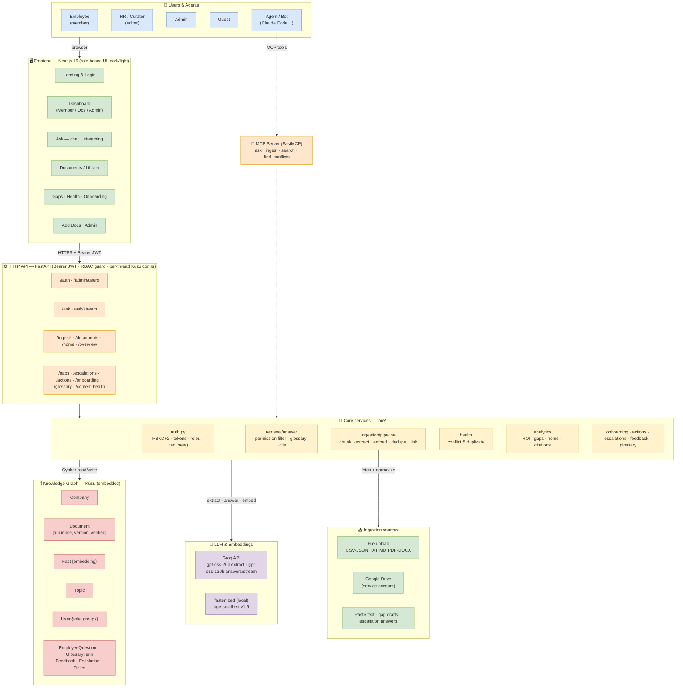

# Lore — System Architecture

> Renders automatically on GitHub. An editable **draw.io** version is in
> [`lore-architecture.drawio`](./lore-architecture.drawio) — open it at
> [app.diagrams.net](https://app.diagrams.net) or with the VS Code "Draw.io Integration" extension.

## Deployment

Docker Compose → **api** (uvicorn, embedding model baked into the image) + **web** (Next.js standalone), a persistent named volume for the Kùzu graph, and `GROQ_API_KEY` injected at runtime from `.env`.

## Request flow (an answer)

1. Browser sends the question with a **Bearer token** → API resolves **identity (company, groups, role)**.
2. `retrieve()` embeds the (glossary-expanded) query, scores every **Fact** by cosine, and **drops facts the caller's groups can't see**.
3. Top facts + their source **Documents** go to Groq (`gpt-oss-120b`) which **synthesizes an answer and cites `[n]`**.
4. The response streams back; the question is **logged** (topic, answered?), and cited docs get a **citation bump**.
